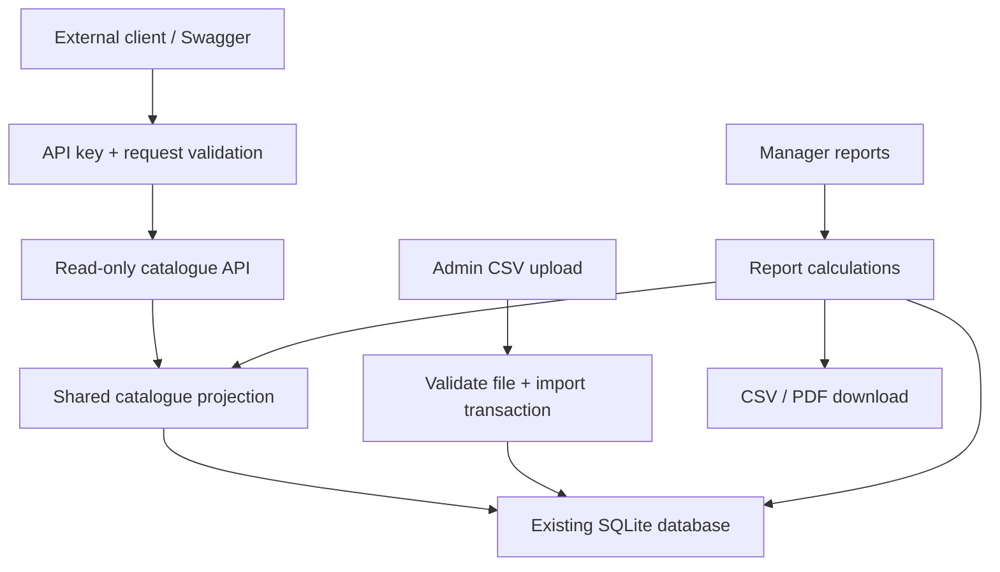

# Final group portfolio assembly checklist

This checklist is a handoff document. It is not the final portfolio and does not replace the other members' sections.

| Section | Responsible contributor | Completion check |
|---|---|---|
| Cover page | Member 3 coordinating | Correct unit, assessment, group, names, IDs and submission date |
| Project overview and plan | All; Member 3 assembling | Chosen baseline, goals, timeline, dependencies and project-board link |
| Team contract | Member 2 | Genuine agreed responsibilities and expectations |
| Requirements and notes | Member 2 with all members | Every brief requirement mapped to implementation and evidence |
| Team approach | Member 2 | Actual workflow, communication, review and merging approach |
| Billable tasks and allocations | Member 3 | Manageable tasks, owners and hours; estimates clearly separated from actuals |
| Meeting minutes | Member 2 | Real meetings, attendees, decisions and actions |
| Installation and running instructions | Member 1 | Git/location branch instructions and successful VM execution evidence |
| Patron search guide or video | Member 1 | Public search steps and usable video link if applicable |
| Integration diagrams | All; Member 3 assembling | Show kiosk/API/import/reporting and reservation/notification/branch connections |
| User journey maps | Each feature owner | Explain the new workflows with success/error outcomes |
| Strengths and weaknesses | Member 3 coordinating | Specific team evidence, impact and responses |
| Validation and screenshots | Each feature owner | Feature coverage and integration results; no fabricated results |
| Repository and marker access | All | Correct final commit/branch and working read access |

## Member 3 integration diagram

## Member 3 journey maps

| Actor | Start | Action | Success | Error or alternative |
|---|---|---|---|---|
| External developer | Swagger or HTTP client | Supply key and request items/categories/status | JSON response containing permitted catalogue data | Missing/invalid key: 401; invalid filter: 400; request limit: 429 |
| Admin | Staff login, Import catalogue | Download sample, prepare/upload CSV | All valid rows saved; result shows count | Any invalid row: errors shown; nothing saved |
| Manager | Staff login, Reports & exports | Select report/range and inspect totals | Matching records and consistent totals | Invalid range or inventory dates: validation shown |
| Manager | Completed report | Choose CSV or PDF | Download containing scope, summaries and detail rows | Unsupported export format rejected |

Add Member 1 and Member 2 journeys and a combined system diagram before creating the final PDF. Obtain each member's review, open every link, check image readability and confirm access after export.
